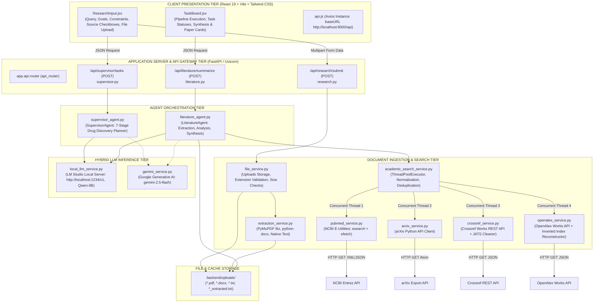

# ResearchPilot: Multi-Agent AI Research Accelerator for Drug Discovery
## Detailed Technical Documentation and Project Report Context

---

## LIST OF ABBREVIATIONS

| Abbreviation | Expanded Form |
| :--- | :--- |
| **ADMET** | Absorption, Distribution, Metabolism, Excretion, and Toxicity |
| **AI** | Artificial Intelligence |
| **API** | Application Programming Interface |
| **arXiv** | Open-access preprint repository for Computer Science, Physics, Quantitative Biology |
| **ASGI** | Asynchronous Server Gateway Interface |
| **BACE1** | Beta-secretase 1 (Beta-site APP cleaving enzyme 1) |
| **ChEMBL** | Chemical database of bioactive molecules with drug-like properties |
| **CORS** | Cross-Origin Resource Sharing |
| **CPU** | Central Processing Unit |
| **Crossref** | Official Digital Object Identifier (DOI) Registration Agency |
| **CSS** | Cascading Style Sheets |
| **DFT** | Density Functional Theory |
| **DOI** | Digital Object Identifier |
| **DOCX** | Microsoft Word Open XML Document |
| **EC50** | Half Maximal Effective Concentration |
| **FIT** | Feature Inversion Technique |
| **GNN** | Graph Neural Network |
| **GPU** | Graphics Processing Unit |
| **HTML** | HyperText Markup Language |
| **HTTP / HTTPS** | Hypertext Transfer Protocol / Hypertext Transfer Protocol Secure |
| **HTS** | High-Throughput Screening |
| **IC50** | Half Maximal Inhibitory Concentration |
| **IP** | Intellectual Property |
| **ITC** | Isothermal Titration Calorimetry |
| **JATS** | Journal Article Tag Suite |
| **JSON** | JavaScript Object Notation |
| **Kd** | Dissociation Constant |
| **Ki** | Inhibitor Constant |
| **KRAS** | Kirsten Rat Sarcoma Viral Oncogene Homolog |
| **LLM** | Large Language Model |
| **MD** | Molecular Dynamics |
| **MoA** | Mechanism of Action |
| **NCBI** | National Center for Biotechnology Information |
| **NIH** | National Institutes of Health |
| **NLP** | Natural Language Processing |
| **OpenAlex** | Open scientific graph containing 250M+ scholarly works |
| **PDB** | Protein Data Bank |
| **PDF** | Portable Document Format |
| **PK/PD** | Pharmacokinetics / Pharmacodynamics |
| **PMID** | PubMed Unique Identifier |
| **PubMed** | Biomedical and life sciences citations database maintained by NCBI/NLM |
| **PyMuPDF** | Python bindings for MuPDF high-performance rendering/extraction library |
| **QSAR** | Quantitative Structure-Activity Relationship |
| **REST** | Representational State Transfer |
| **Ro5** | Lipinski’s Rule of Five |
| **SAR** | Structure-Activity Relationship |
| **SDK** | Software Development Kit |
| **SPA** | Single Page Application |
| **SPR** | Surface Plasmon Resonance |
| **TXT** | Plain Text Document |
| **UI / UX** | User Interface / User Experience |
| **URI / URL** | Uniform Resource Identifier / Uniform Resource Locator |
| **Uvicorn** | Lightning-fast ASGI web server implementation for Python |
| **vHTS** | Virtual High-Throughput Screening |
| **XML** | Extensible Markup Language |

---

# 1. INTRODUCTION

### 1.1 Background and Overview
The traditional drug discovery and development pipeline is notoriously one of the most resource-intensive, prolonged, and high-attrition scientific endeavors in human history. Transforming a novel biochemical hypothesis into a clinically approved therapeutic routinely demands **10 to 15 years** of sustained laboratory research, requires financial investments ranging from **$1.0 to $2.6 billion**, and suffers from an overall clinical failure rate exceeding **90%**. 

The conventional early-stage drug discovery lifecycle comprises several distinct, highly interdependent phases:
1. **Target Identification & Validation:** Pinpointing cellular macromolecules (proteins, enzymes, receptors, or nucleic acids) whose functional modulation can ameliorate a disease phenotype.
2. **Hit Identification & High-Throughput Screening (HTS):** Screening chemical libraries comprising hundreds of thousands of compounds to identify initial molecules with detectable binding affinity for the target.
3. **Hit-to-Lead (H2L) Optimization:** Evaluating chemical analogues to confirm biological activity, verify selectivity over counter-targets, and establish preliminary Structure-Activity Relationships (SAR).
4. **Lead Optimization:** Modifying the core chemical scaffold to simultaneously optimize potency (nanomolar or sub-nanomolar $K_d$ or $\text{IC}_{50}$), pharmacokinetic stability, oral bioavailability, and safety profiles (mitigating off-target toxicity and hERG cardiac liabilities).
5. **Preclinical Pharmacokinetics & ADMET Profiling:** Characterizing Absorption, Distribution, Metabolism, Excretion, and Toxicity across cellular models and mammalian systems prior to human clinical trials.

In parallel with these empirical hurdles, modern pharmaceutical research faces an exponential **biomedical knowledge explosion**. Millions of peer-reviewed articles, clinical studies, and computational models are published annually across decentralized repositories including PubMed (over 36 million citations), arXiv, Crossref (over 150 million DOI records), and OpenAlex (over 250 million cataloged works). Pharmaceutical scientists and medicinal chemists face debilitating cognitive bandwidth bottlenecks. Manually reviewing literature, correlating disparate binding data, extracting active chemical scaffolds, cross-referencing conflicting biological assay outcomes, and formulating comprehensive translational research proposals consumes months of manual effort.

To overcome these structural limitations, **ResearchPilot** was conceptualized and engineered. ResearchPilot is an autonomous, **Multi-Agent Artificial Intelligence Research Accelerator** specialized strictly and exclusively for pharmaceutical, biomedical, and computational drug discovery. By deploying an orchestrated hierarchy of cognitive agents—steered by a central **Supervisor Agent** and executed by specialized domain workers such as the **Literature Search Agent**—ResearchPilot automates literature retrieval across multiple federated scientific databases, parses researcher-provided laboratory documents, extracts pharmacological features, and constructs rigorous, multi-step experimental and computational drug discovery roadmaps.

---

### 1.2 Problem Statement
Despite the proliferation of general-purpose Artificial Intelligence and Large Language Models (LLMs), existing computational tools exhibit significant shortcomings when applied to the rigorous, highly specialized domain of pharmaceutical drug discovery:

1. **Severe Information Fragmentation Across Scientific Silos:** 
   Academic publications and molecular findings are distributed across heterogeneous repositories with disparate query protocols, data schemas, and access patterns. PubMed houses clinical and biomedical articles; arXiv holds cutting-edge artificial intelligence, molecular dynamics, and algorithmic chemistry preprints; Crossref maintains formal publisher DOIs and citations; while OpenAlex aggregates a massive universal scientific graph. Researchers lack a unified, automated interface capable of federating searches across all these repositories simultaneously without requiring complex API configurations or paid aggregator subscriptions.

2. **Domain Hallucination and Generalist Drift in Standard LLMs:**
   Off-the-shelf, general-purpose LLMs lack strict domain guardrails. When presented with open-ended research questions, generic LLMs frequently diverge into unrelated computer science, business, or surface-level biological generalities. In drug discovery, such drift is disastrous: recommendations must be grounded strictly in biochemical feasibility, target druggability, ligand binding kinetics, SAR, and ADMET constraints.

3. **Cognitive Overload in Document Ingestion & Synthesis:**
   Researchers frequently accumulate internal laboratory reports, proprietary assay sheets, and downloaded PDF papers that cannot be synthesized manually alongside external web literature. Existing tools rarely combine local multi-format document ingestion (PDF, DOCX, TXT) with simultaneous real-time web literature discovery into a unified, coherent synthesis.

4. **Lack of Structured, Deterministic Research Workflows:**
   Standard conversational AI interfaces produce unstructured, conversational answers that lack reproducibility, milestone tracking, and task decomposition. Computational drug discovery demands a deterministic, sequential scientific methodology: moving logically from literature mining to hypothesis generation, scientific critique, lead refinement, project roadmap compilation, wet-lab validation design, and memory curation.

5. **Intellectual Property (IP) Vulnerability and Data Privacy Risks:**
   Pharmaceutical targets and candidate chemical structures constitute highly valuable, patentable intellectual property. Transmitting proprietary lead compounds to third-party public cloud APIs exposes biopharma teams to severe IP leak risks. Existing discovery platforms frequently lack support for air-gapped, zero-data-egress local LLM inference engines (such as LM Studio running local open-weight models).

---

### 1.3 Objectives
The primary objective of the ResearchPilot project is to design, develop, and validate an intelligent, multi-agent AI research accelerator engineered strictly for biomedical and pharmaceutical drug discovery research. 

The specific technical objectives include:

1. **Design and Implement a Deterministic Supervisor Agent:**
   Develop an intelligent orchestration agent governed by strict domain prompts that receives a researcher's drug discovery inquiry, therapeutic goals, and pharmacological constraints, and deterministically generates an end-to-end, sequential 7-agent execution pipeline.
2. **Engineer a Zero-API-Key Multi-Source Federated Academic Search Engine:**
   Implement an asynchronous, concurrent retrieval engine capable of querying PubMed (via NCBI E-Utilities), arXiv (via Python API), Crossref (via REST API), and OpenAlex (via Works API) without requiring paid third-party access keys, complete with title normalization, deduplication, and source quota balancing.
3. **Establish a Robust Document Ingestion and Content Extraction Pipeline:**
   Build a multi-format document parsing subsystem utilizing PyMuPDF (`fitz`), `python-docx`, and native text decoders to ingest, validate, sanitize, and cache user-uploaded literature in PDF, DOCX, and TXT formats.
4. **Develop a Specialized Literature Search & Synthesis Agent:**
   Implement an autonomous literature agent that:
   - Derives high-precision pharmacological search keywords using domain-prompted NLP.
   - Evaluates uploaded internal documents strictly for therapeutic targets, bioactive molecules, binding affinities ($K_d, K_i, \text{IC}_{50}$), and ADMET metrics.
   - Evaluates web-discovered papers across selected academic repositories.
   - Generates a holistic cross-literature scientific synthesis highlighting consensus mechanisms, computational methodologies, and translational bottlenecks.
5. **Implement Dual-Inference Compatibility (Local Air-Gapped LLM vs. Cloud API):**
   Architect a modular LLM service layer supporting both local inference via LM Studio (OpenAI-compatible REST server hosting Qwen-8B for complete IP confidentiality) and cloud inference via the Google Gemini API (Gemini-2.5-Flash) with guaranteed JSON output formatting.
6. **Construct a Modern, Responsive Research Interface:**
   Deliver a high-performance Single Page Application (SPA) utilizing React 19, Vite, and Tailwind CSS featuring dynamic academic source toggles, real-time pipeline status tracking, and structured literature inspection panels.

---

### 1.4 Contributions of the Work
The key academic and engineering contributions realized in this project are as follows:

* **Strict Domain Enforcement via Constrained System Prompts:** 
  Engineered prompt architectures and system roles that strictly restrict model reasoning to pharmaceutical drug discovery. If an ambiguous or non-therapeutic query is entered, the engine automatically grounds and reframes the inquiry into druggable biological targets, small molecules, biologics, or pharmacological mechanisms, completely eliminating generalist drift.
* **Seven-Stage Structured Drug Discovery Pipeline Decomposition:**
  Formulated a scientific decomposition schema translating high-level discovery objectives into seven discrete agent stages:
  1. *Literature Search Agent*
  2. *Hypothesis Generator Agent*
  3. *Critic & Evidence Agent*
  4. *Refinement & Research Planner Agent*
  5. *Research Plan Compilation*
  6. *Human Experimentation & Wet-Lab Protocol Designer*
  7. *Memory Update & Learning Loop*
* **Concurrent Multi-Repository Federated Ingestion Architecture:**
  Constructed a multi-threaded academic search aggregator utilizing Python's `ThreadPoolExecutor` that executes simultaneous queries across PubMed, arXiv, Crossref, and OpenAlex. Implemented an alphanumeric title-normalization algorithm that purges duplicate preprints and published variants across registries.
* **Hybrid Air-Gapped Privacy Architecture for Biopharma IP:**
  Established a local LLM integration layer interfacing directly with LM Studio over `localhost:1234`, enabling researchers to process proprietary chemical structures, confidential target assays, and unpublished manuscripts locally without transmitting single bytes over the public internet.
* **Automated Pharmacological Abstract Reconstruction:**
  Developed an inverted-index decoding algorithm capable of reconstructing full-text abstracts from OpenAlex's tokenized inverted indices, enabling seamless zero-key extraction of modern peer-reviewed publications.

---

### 1.5 Scope and Applications

#### 1.5.1 Scope of the Project
* **In-Scope:**
  * Automated decomposition of drug discovery queries into structured agent execution pipelines.
  * Ingestion, text extraction, and contextual summarization of uploaded PDF, DOCX, and TXT research documents.
  * Federated querying, deduplication, and metadata harvesting across PubMed, arXiv, Crossref, and OpenAlex.
  * Pharmacological entity extraction (targets, small molecules, binding affinities, assay techniques, ADMET properties).
  * Automated generation of cross-literature research syntheses and identification of therapeutic opportunities.
  * Dual-mode LLM execution (local LM Studio and cloud Google Gemini).
* **Out-of-Scope:**
  * Direct physical robotics wet-lab automation (automated liquid handling or pipetting).
  * Real-time Quantum Mechanical Density Functional Theory (DFT) calculations (delegated as explicit tasks for specialized computational software within generated research plans).
  * Formal regulatory dossier submissions (e.g., FDA Investigational New Drug application filing).

#### 1.5.2 Practical Applications
1. **Target Identification & Validation in Academic Oncology & Neurology:**
   Academic laboratories investigating challenging disease targets (e.g., KRAS G12D, BACE1, Tau aggregates) can instantly aggregate literature, pinpoint validated binding pockets, and formulate screening hypotheses.
2. **Early-Stage Biotech Hit-to-Lead Acceleration:**
   Biotechnology startups with limited headcount can automate the initial literature survey and task formulation stages, compressing weeks of literature review into seconds.
3. **Virtual Screening & Molecular Modeling Protocol Design:**
   Computational chemistry teams can utilize the platform to draft detailed workflows for molecular docking, molecular dynamics (MD) simulations, and free-energy perturbation calculations.
4. **Drug Repurposing & Polypharmacology Analysis:**
   Researchers can query known pharmaceutical compounds to uncover off-target biological mechanisms and evaluate potential efficacy against secondary indications.

---

### 1.6 Organization of the Report
This documentation is structured into the following chapters:
* **LIST OF ABBREVIATIONS:** Comprehensive glossary of chemical, pharmaceutical, and technical acronyms used throughout the document.
* **CHAPTER 1: INTRODUCTION:** Covers the background of drug discovery, problem statement, project objectives, major contributions, operational scope, and report organization.
* **CHAPTER 2: LITERATURE REVIEW & THEORETICAL FOUNDATIONS:** Explores existing methodologies in computational drug discovery, LLM agent architectures, academic search APIs, and local inference models.
* **CHAPTER 3: SYSTEM DESIGN & ARCHITECTURE:** Detailed specification of the multi-tier system architecture, individual hardware and software components, mathematical and programmatic data flows, module responsibilities, and deployment environments.
* **CHAPTER 4: IMPLEMENTATION DETAILS:** Line-by-line breakdown of algorithms, prompt templates, API integrations, schema definitions, and frontend components.
* **CHAPTER 5: EXPERIMENTAL RESULTS & VALIDATION:** Empirical demonstration of system performance, Supervisor Agent decomposition validation, literature retrieval precision, and synthesis evaluation on real-world drug targets (e.g., KRAS G12D).
* **CHAPTER 6: CONCLUSION & FUTURE ENHANCEMENTS:** Summarizes achievements, discusses limitations, and outlines future milestones (vector databases, automated docking integrations, and agent-to-agent autonomous collaboration).

---

# 3. SYSTEM DESIGN



---

### 3.1 System Architecture
The architecture of **ResearchPilot** adheres to a decoupled, multi-tiered service-oriented design pattern engineered for high throughput, modularity, and strict data governance. As depicted in the architectural diagram, the system is segmented into six primary operational tiers:

1. **Client Presentation Tier:**
   Developed as a Single Page Application (SPA) utilizing **React 19**, **Vite**, and **Tailwind CSS**. It manages interactive user state, form validation via `react-hook-form`, multi-source academic repository selection, file upload staging, and dynamic rendering of agent workflows and literature analyses.
2. **Application Server & API Gateway Tier:**
   Powered by **FastAPI** running atop the high-performance asynchronous **Uvicorn** ASGI server in a **Python 3.12** environment. It serves as the gateway exposing RESTful endpoints, validating data payloads against strict **Pydantic** schemas, managing Cross-Origin Resource Sharing (CORS), and routing execution to backend agents.
3. **Agent Orchestration Tier:**
   Houses the core cognitive intelligence units:
   - **Supervisor Agent:** Deconstructs complex drug discovery queries into a 7-stage sequential execution plan.
   - **Literature Search Agent:** Coordinates query formulation, document reading, external database search, per-paper analysis, and cross-literature research synthesis.
4. **Document Ingestion & Multi-Source Search Tier:**
   Handles the ingestion and extraction of unstructured laboratory files (PDF, DOCX, TXT) and coordinates concurrent queries across four independent scientific databases (PubMed, arXiv, Crossref, OpenAlex) using thread pools and deduplication algorithms.
5. **Hybrid LLM Inference Tier:**
   Provides an abstraction layer between cognitive reasoning and model execution. Supports zero-data-egress local inference via **LM Studio** (`local_llm_service.py`) running quantized models (e.g., Qwen 2.5 / Qwen 3 8B) for proprietary drug discovery queries, with automatic compatibility for cloud-hosted **Google Gemini** models (`gemini_service.py`).
6. **File Storage & Cache Tier:**
   Manages the local filesystem directory structure (`backend/uploads/`), persisting uploaded binary papers alongside normalized text extracts for rapid agent consumption.

---

### 3.2 Module Description
The codebase is structured into modular, single-responsibility components across the backend and frontend repositories:

#### 3.2.1 Frontend Client Modules (`frontend/src/`)
* **`App.jsx`:** The root React component establishing client-side routing via `react-router-dom` (`BrowserRouter`, `Routes`, `Route`). Enforces the base layout wrapper and configures routes for `/` (`ResearchInput`) and `/tasks` (`TaskBoard`).
* **`components/layout/Layout.jsx`:** Provides the consistent navigation header, logo branding, active route links, and visual indicators (including the "Drug Discovery" pharmaceutical badge).
* **`pages/ResearchInput.jsx`:** The primary mission configuration interface. Features:
  - Text inputs for *Drug Discovery Research Question*, *Therapeutic Goals*, and *Pharmacological Constraints*.
  - Academic source selection cards (arXiv, PubMed, OpenAlex, Crossref) with dynamic state toggles and selection counters.
  - Drag-and-drop / file browser component supporting multi-file uploads (`.pdf`, `.docx`, `.txt`).
  - Form submission orchestrator that dispatches multipart form data to `/api/research/submit` and subsequent pipeline requests to `/api/supervisor/tasks`.
* **`pages/TaskBoard.jsx`:** The execution and inspection dashboard. Features:
  - Real-time pipeline step list rendering all 7 agent tasks with dynamic status indicators (`pending`, `in-progress`, `completed`).
  - Pipeline execution trigger dispatching requests to `/api/literature/summarize`.
  - Comprehensive results renderer displaying the *Scientific Landscape & Synthesis* banner, *Uploaded Research Papers* cards, and *Discovered Scientific Papers* cards with source badges, author rosters, publication years, DOI links, and key extracted points.
* **`services/api.js`:** Centralized Axios instance configured with `baseURL: http://localhost:8000/api` and default HTTP headers.

#### 3.2.2 API Route Controllers (`backend/app/api/`)
* **`router.py`:** Aggregates sub-routers (`research.router`, `supervisor.router`, `literature.router`) under the global `/api` prefix.
* **`routes/research.py`:** Exposes `POST /api/research/submit`. Consumes multipart form data containing research parameters and uploaded files, invokes `file_service.save_upload_files`, parses selected sources, and returns structured metadata.
* **`routes/supervisor.py`:** Exposes `POST /api/supervisor/tasks`. Receives `SupervisorRequest`, delegates planning to `supervisor_agent.process()`, and returns validated `SupervisorResponse` JSON containing 7 structured agent tasks.
* **`routes/literature.py`:** Exposes `POST /api/literature/summarize`. Receives `LiteratureRequest`, delegates retrieval, paper analysis, and cross-synthesis to `literature_agent.process()`, and returns `LiteratureResponse`.

#### 3.2.3 AI Agents (`backend/app/agents/`)
* **`supervisor_agent.py`:**
  - Implements `SupervisorAgent` class.
  - Houses the master system prompt defining the persona of the ResearchPilot Supervisor Agent, strictly bounded to pharmaceutical drug discovery.
  - Defines the deterministic 7-agent sequential order.
  - Formats user input parameters (question, goals, constraints, file metadata) into structured LLM prompts and parses returned JSON into Pydantic models.
* **`literature_agent.py`:**
  - Implements `LiteratureAgent` class.
  - Manages four specialized prompt templates:
    1. `uploaded_paper_prompt`: Analyzes user-provided documents for biological targets, compound structures, binding affinities, and SAR.
    2. `web_paper_prompt`: Evaluates external papers discovered via academic search APIs.
    3. `synthesis_prompt`: Synthesizes collective findings into a coherent therapeutic landscape analysis.
    4. `generate_search_query`: Extracts 3 to 6 optimized academic keywords tailored for PubMed and academic database querying.
  - Coordinates text truncation (capping at 10,000 characters to prevent context window overflow) and aggregates paper summaries into unified response objects.

#### 3.2.4 External Academic Search Services (`backend/app/services/`)
* **`academic_search_service.py`:**
  - Coordinates concurrent search execution across selected academic repositories.
  - Utilizes Python's `concurrent.futures.ThreadPoolExecutor` with worker pools capped at `min(len(sources), 4)`.
  - Allocates query result quotas dynamically across sources.
  - Implements alphanumeric title normalization (`re.sub(r'[^a-zA-Z0-9]', '', title).lower()`) to deduplicate cross-listed papers.
* **`pubmed_service.py`:**
  - Interfaces with NCBI Entrez E-Utilities (`https://eutils.ncbi.nlm.nih.gov/entrez/eutils`).
  - Cleans raw input strings into normalized PubMed query terms.
  - Performs two-step fetching: `esearch.fcgi` (retrieving relevant PMIDs in JSON) followed by `efetch.fcgi` (retrieving full XML records).
  - Parses XML trees via `xml.etree.ElementTree`, extracting ArticleTitle, AbstractText, AuthorList, and publication years.
* **`arxiv_service.py`:**
  - Connects to the arXiv repository via the official `arxiv` Python client.
  - Implements query sanitation, relevance sorting, and metadata harvesting (Title, Authors, Summary, Entry ID, PDF URL, Primary Category).
* **`crossref_service.py`:**
  - Queries the Crossref REST API (`https://api.crossref.org/works`) indexing over 150 million DOI records.
  - Purges JATS and XML markup (e.g., `<jats:p>`, `<jats:sec>`) from abstracts via regex.
  - Extracts DOIs, journal containers, author rosters, publication dates, and direct PDF links where available.
* **`openalex_service.py`:**
  - Interfaces with OpenAlex Works API (`https://api.openalex.org/works`).
  - Implements an inverted-index reconstruction algorithm:
    $$\text{Abstract} = \text{Join}(\text{SortByPosition}(\{ (pos, word) \mid word \in \text{index}, pos \in \text{index}[word] \}))$$
  - Resolves Open Access PDF links and primary concept categorizations.

#### 3.2.5 Document Handling & Parsing Services (`backend/app/services/`)
* **`file_service.py`:**
  - Validates file extensions against `.pdf`, `.docx`, and `.txt`.
  - Enforces maximum file size thresholds (`MAX_FILE_SIZE_MB = 20 MB`).
  - Persists binary uploads to disk and dispatches content extraction.
  - Caches extracted text to `_extracted.txt` files for rapid downstream agent ingestion.
* **`extraction_service.py`:**
  - `extract_text_from_pdf()`: Extracts text across all pages using PyMuPDF (`fitz.open()`).
  - `extract_text_from_docx()`: Extracts paragraph text using `python-docx` (`Document()`).
  - `extract_text_from_txt()`: Reads standard UTF-8 text files.

#### 3.2.6 LLM Inference Services (`backend/app/services/`)
* **`local_llm_service.py`:**
  - Connects to a locally running instance of **LM Studio** exposing an OpenAI-compatible REST API on `http://localhost:1234/v1`.
  - Configures the local model identifier (e.g., `qwen_qwen3-8b`).
  - Injects a strict system prompt:
    > *"You are ResearchPilot AI, an expert research intelligence system strictly and exclusively specialized in biomedical, biochemical, and pharmaceutical drug discovery research. You support ONLY tasks and questions directly relating to drug discovery... You MUST output ONLY valid JSON."*
  - Automatically sanitizes output by stripping Markdown code fences (````json ... ````) before executing `json.loads()`.
* **`gemini_service.py`:**
  - Connects to Google's Generative AI API using the official `google-generativeai` SDK.
  - Instantiates `genai.GenerativeModel(settings.GEMINI_MODEL)` configured with domain-specific `system_instruction`.
  - Requests JSON output formatting via `response_mime_type="application/json"`.

#### 3.2.7 Data Validation Schemas (`backend/app/schemas/`)
* **`research.py`:** Defines `UploadedFileMeta`, `ResearchSubmitResponse`, and `SupervisorRequest`.
* **`supervisor.py`:** Defines `AgentTask` (`agent: str`, `task: str`) and `SupervisorResponse` (`workflow_name: str`, `agent_tasks: List[AgentTask]`).
* **`literature.py`:** Defines `LiteratureRequest`, `PaperSummary`, and `LiteratureResponse` (containing full paper lists, uploaded summaries, discovered papers, and cross-synthesis text).

---

### 3.3 Data Flow and System Workflow
The operational execution of ResearchPilot proceeds across three sequential, end-to-end data flows:

#### 3.3.1 Data Flow 1: Research Submission & Document Ingestion
```
[User Browser]
      │
      │ 1. Multipart Form Data (Question, Goals, Constraints, Sources, Files)
      ▼
[POST /api/research/submit]
      │
      │ 2. Stream files to disk (backend/uploads/)
      ▼
[file_service.py]
      │
      │ 3. Extension check (.pdf, .docx, .txt) & Size check (<=20MB)
      │ 4. Dispatch to extraction_service.py
      ▼
[extraction_service.py] ──> PyMuPDF / python-docx / UTF-8
      │
      │ 5. Save normalized text to *_extracted.txt
      ▼
[ResearchSubmitResponse JSON] ──> Returned to React Frontend
```

#### 3.3.2 Data Flow 2: Supervisor Agent Pipeline Planning
```
[User Browser]
      │
      │ 1. POST /api/supervisor/tasks (SupervisorRequest JSON)
      ▼
[supervisor_agent.py]
      │
      │ 2. Compile prompt_template with:
      │    - Drug Discovery Research Question
      │    - Therapeutic Goals
      │    - Pharmacological Constraints
      │    - Uploaded File Metadata JSON
      ▼
[local_llm_service.py] (or gemini_service.py)
      │
      │ 3. Send system prompt (Drug Discovery only) + user prompt
      │    to LM Studio (localhost:1234, Qwen-8B)
      ▼
[LLM Token Generation]
      │
      │ 4. Output Raw JSON string
      ▼
[JSON Sanitation & Validation]
      │
      │ 5. Strip ```json code fences -> json.loads() -> SupervisorResponse(**dict)
      ▼
[TaskBoard.jsx] ──> Renders 7-stage drug discovery pipeline on client
```

#### 3.3.3 Data Flow 3: Literature Search, Analysis, & Cross-Synthesis
```
[User clicks "Execute Drug Discovery Pipeline"]
      │
      │ 1. POST /api/literature/summarize (LiteratureRequest JSON)
      ▼
[literature_agent.py]
      │
      ├───────────────────────────────────────────────────────────────────┐
      │ Step 3A: Ingest Uploaded Documents                                │ Step 3B: Discover Academic Literature
      ▼                                                                   ▼
[Read *_extracted.txt from disk]                                    [generate_search_query(question)]
      │                                                                   │ (Prompt LLM for 3-6 drug discovery keywords)
      │ Truncate content to 10,000 chars                                  ▼
      │                                                             [academic_search_service.search()]
      ▼                                                                   │
[uploaded_paper_prompt -> LLM]                                            │ Concurrently query via ThreadPoolExecutor:
      │                                                                   ├─► PubMed (NCBI E-Utilities)
      ▼                                                                   ├─► arXiv (API Client)
[PaperSummary (Target, Compound, Affinities)]                             ├─► Crossref (Works API)
      │                                                                   └─► OpenAlex (Inverted Index Abstract)
      │                                                                   │
      │                                                                   ▼
      │                                                             [Deduplicate papers via normalized titles]
      │                                                                   │
      │                                                                   ▼
      │                                                             [web_paper_prompt -> LLM per paper]
      │                                                                   │
      │                                                                   ▼
      │                                                             [PaperSummary list (Web-Discovered)]
      │                                                                   │
      └───────────────────────────────┬───────────────────────────────────┘
                                      │
                                      ▼
                      [Step 3C: Cross-Literature Synthesis]
                                      │
                                      │ Format all papers into summary descriptions
                                      │ Dispatch synthesis_prompt to LLM
                                      ▼
                      [synthesis_prompt -> LLM]
                                      │
                                      │ Generate cohesive drug landscape analysis
                                      ▼
                      [LiteratureResponse JSON]
                                      │
                                      ▼
                      [TaskBoard.jsx Client UI]
                      (Displays Synthesis, Uploaded Cards, and Web Cards)
```

---

### 3.4 Infrastructure and Deployment Environment

#### 3.4.1 Hardware Requirements
* **Standard Development / Inference Profile:**
  * **Processor (CPU):** Intel Core i7 / i9 (10th Gen or newer) or AMD Ryzen 7 / 9 (8 physical cores minimum).
  * **System Memory (RAM):** 16 GB DDR4/DDR5 minimum (32 GB recommended when running LM Studio concurrently with development servers).
  * **Dedicated GPU (for Local LLM Inference):** NVIDIA GeForce RTX 3060 / 4060 or higher with a minimum of **8 GB VRAM** (supports full 4-bit / 8-bit quantization offloading of Qwen 2.5 / Qwen 3 8B). Alternatively, Apple Silicon (M1/M2/M3 Pro/Max/Ultra) with 16 GB+ unified memory.
  * **Storage:** 10 GB free solid-state drive (NVMe SSD recommended for high-speed file streaming and model loading).

#### 3.4.2 Software & Runtime Environment
* **Operating System:** Microsoft Windows 10/11 (64-bit), Ubuntu Linux 22.04 LTS+, or macOS Sonoma+.
* **Python Runtime:** Python **3.12.x** (managed via isolated virtual environment `.venv`).
  * Core dependencies: `fastapi`, `uvicorn`, `pydantic`, `pydantic-settings`, `python-multipart`, `fitz` (PyMuPDF), `python-docx`, `requests`, `arxiv`, `google-generativeai`, `openai`.
* **Node.js Runtime:** Node.js **v20.x** LTS (or v18.x) with `npm` (Node Package Manager).
  * Frontend dependencies: `react` (v19.2), `react-dom` (v19.2), `react-router-dom` (v7.1), `react-hook-form` (v7.8), `axios` (v1.2), `lucide-react` (v1.4), `tailwindcss` (v3.4), `vite` (v8.3).
* **Local LLM Engine:** **LM Studio** (v0.3.x) configured to expose an OpenAI-compatible local HTTP server on port `1234`.
  * Quantized Model: `qwen_qwen3-8b` (or `qwen2.5-7b-instruct`).
  * Context Window: 4,096 to 8,192 tokens.
* **Network & Security Infrastructure:**
  * Local host ports: Port `5173` (Frontend Vite Dev Server), Port `8000` (Backend FastAPI Uvicorn Server), Port `1234` (LM Studio Local Inference Server).
  * Outbound HTTP/HTTPS access required to:
    - `https://eutils.ncbi.nlm.nih.gov` (PubMed NCBI API)
    - `https://export.arxiv.org` (arXiv API)
    - `https://api.crossref.org` (Crossref API)
    - `https://api.openalex.org` (OpenAlex API)
  * No inbound public internet ports required; the system operates safely within an air-gapped local intranet.
