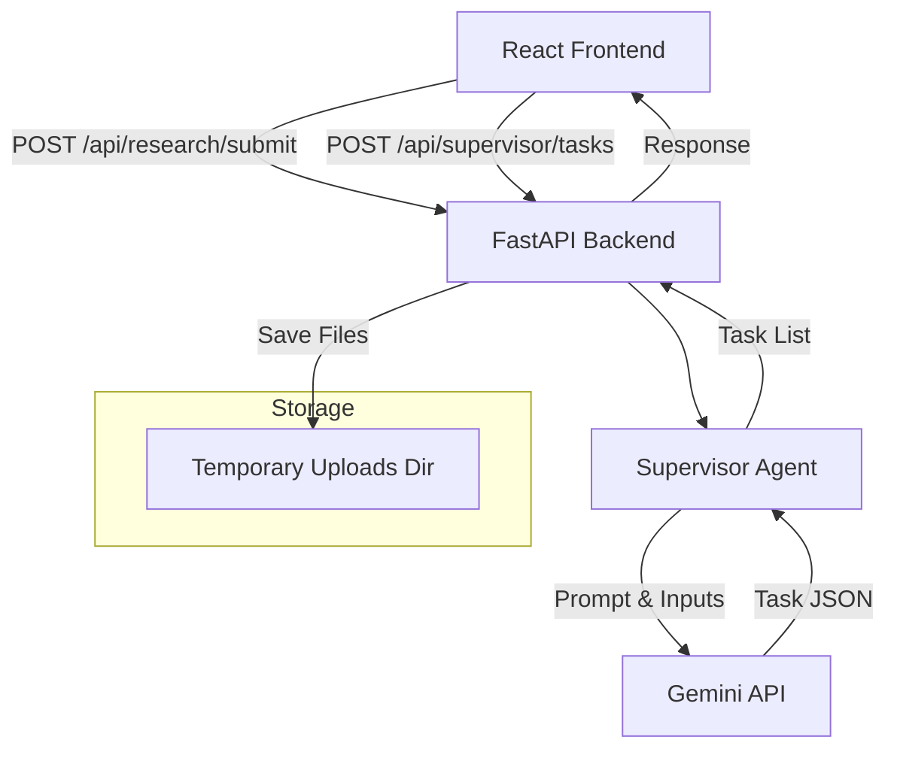

# ResearchPilot Architecture

## Phase 1 Overview

The Phase 1 architecture of ResearchPilot establishes the foundation for a multi-agent system. It focuses on receiving research parameters and breaking them down into actionable steps using the Supervisor Agent.

### Simple Architecture Diagram

### Future Extensibility

The system is designed to plug in future agents without changing the core folder structure:

- **Literature Search Agent**: Will be placed in `backend/app/agents/literature_agent.py`. The Supervisor Agent will be able to dispatch search tasks to this agent.
- **Hypothesis Generator**: Will be placed in `backend/app/agents/hypothesis_agent.py`. It will consume processed data and interact with Gemini to output new hypotheses.
- **Critic Agent**: Will be implemented in `backend/app/agents/critic_agent.py` to evaluate the outputs from other agents against rigorous standards.
- **Research Planner & Memory**: Future states will migrate `backend/uploads/` to persistent storage (e.g., PostgreSQL, S3) and integrate a Vector Database (like OpenSearch) to allow agents to retrieve historical context.
